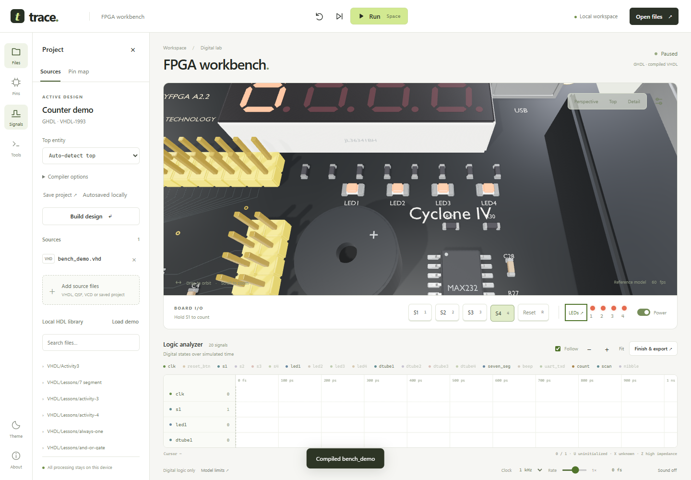
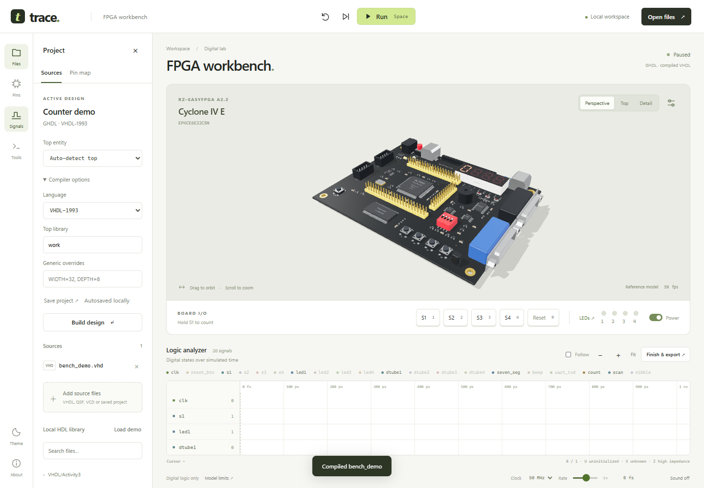

# Trace FPGA Workbench — User Tutorial

For CJ and anyone learning to use this local VHDL workbench.

**Start here:** launch the app, try the counter demo, then work through the AND-gate example. You do not need an FPGA board or a SOF/POF file for these exercises.

## Contents

1. [Launch the website](#1-launch-the-website)
2. [Try the built-in counter demo](#2-try-the-built-in-counter-demo)
3. [Find your way around](#3-find-your-way-around)
4. [Run your first VHDL design](#4-run-your-first-vhdl-design)
5. [Control the board LEDs with your own code](#5-control-the-board-leds-with-your-own-code)
6. [Map design ports to board pins](#6-map-design-ports-to-board-pins)
7. [Read and export waveforms](#7-read-and-export-waveforms)
8. [Understand the clock and simulation controls](#8-understand-the-clock-and-simulation-controls)
9. [Run an automated VHDL testbench](#9-run-an-automated-vhdl-testbench)
10. [Save, reopen, and edit projects](#10-save-reopen-and-edit-projects)
11. [Use libraries, generics, and data files](#11-use-libraries-generics-and-data-files)
12. [Use UART and timing annotations](#12-use-uart-and-timing-annotations)
13. [Choose the right file format](#13-choose-the-right-file-format)
14. [Troubleshoot problems](#14-troubleshoot-problems)
15. [Shortcuts and limitations](#15-shortcuts-and-limitations)

## 1. Launch the website

1. Open `C:\Users\cmpj\dev\fpga-lab` in File Explorer.
2. Double-click **start.bat**.
3. The launcher starts the local server and opens your browser.
4. If no browser opens, visit **http://127.0.0.1:8044/** manually.
5. Keep the server's terminal window open while using the website.

If the server is already running, launching again reuses it. Closing that second launcher window does not stop the original server.

You can also run this command in a terminal:

```powershell
node "C:\Users\cmpj\dev\fpga-lab\server.mjs"
```

Then open the same address manually. Do not double-click the HTML file: the app needs its local server to compile and run VHDL.

The configured installation uses Node.js, GHDL, and a native bridge. Its website assets are local; normal use does not require an internet connection. Use a modern browser with WebGL enabled for the 3D board.

**Before shutting down:** save your project and export any waveform you need. Stop the original server with `Ctrl+C` in its terminal. A saved project preserves the design, not a running simulation.

## 2. Try the built-in counter demo

> If you already have work open, choose **Files > Sources > Save project** first. **Load demo** replaces the current source set and resets its pin assignments and compiler settings.

1. Click **Files** on the left rail.
2. In the **Sources** tab, find **Local HDL library** and click **Load demo**.
3. Wait for **Counter demo** and the **Paused** status.
4. Set **Clock** to **1 kHz** for an easy first experiment.
5. Click **Run**.
6. Hold the keyboard's **1** key, or press and hold **S1** below the board.
7. Release it to stop incrementing the counter.
8. Click **Run** again to pause the simulation.

The counter is 24 bits wide. The four-digit display shows its low 16 bits in **hexadecimal**, not decimal; `A` through `F` represent values 10 through 15. The analyzer's `count` signal lets you inspect the wider value.

### Demo controls

These actions belong to the demo's VHDL. Your own design decides what the same buttons do.

| Control | Keyboard | Demo action |
|---|---|---|
| S1 | Hold `1` | Increment on each rising clock edge |
| S2 | Hold `2` | Clear the counter's low eight bits on a rising edge |
| S3 | Hold `3` | Decrement on each rising edge; takes priority over S1 |
| S4 | Hold `4` | Lamp test: turn on all four LEDs and the seven main display segments |
| Board Reset | Hold `R` | Clear the counter and scan position on a rising edge |

For the lamp test, run the simulation while holding **S4** so all four multiplexed digits are visited. The decimal points remain off.

### Where are the four LEDs?

Click **LEDs** beside the four small indicators below the board. The camera moves to the physical LED1–LED4 components, below the seven-segment display and above the buzzer.



### Important: reset is not restart

- **Board Reset / R** drives the design's active-low `reset_btn` input. The demo uses a synchronous reset, so it needs a clock edge. While paused, hold **R** and click **Step**.
- The **circular-arrow button at the top** restarts the native simulation by rebuilding it. This discards the current run and starts again from time zero.

Click blank space before using global shortcuts if a text field is focused.

## 3. Find your way around



Screenshots illustrate the layout; your design, clock, open panels, and signal values may differ.

| Area | What it does |
|---|---|
| Top circular arrow | Restart the current simulation, or rewind a VCD replay |
| Top Step icon | Advance one generated clock cycle; in replay, advance one recorded timestamp |
| Run / Pause | Start or pause automatic advancement |
| Open files | Import local source files, artifacts, or a saved Trace project |
| Files | Sources, top entity, compiler options, project saving, and local HDL library |
| Pins | Connect board nets to your design's ports or individual vector bits |
| Signals | Show or hide the logic analyzer |
| Tools | Console, Truth table, UART, and Bitstream inspection |
| About / Model limits | Explain supported behavior and what is not simulated |
| Board I/O | S1–S4, Reset, LED indicators, and virtual Power |
| Controls below the board | Additional top-level inputs not exclusively represented by board controls |
| Bottom Clock and Rate | Generated clock frequency and simulation advancement rate |

### Inspect the 3D board

- Drag the board to orbit the camera; scroll to zoom.
- Use **Perspective**, **Top**, or **Detail** for quick views.
- Open the sliders-shaped **View settings** button for more camera views, including **Four LEDs**, **Display detail**, **Connectors**, and **Underside**.
- **Exploded view** separates component assemblies for inspection.
- **Display persistence** changes how multiplexed digits remain visible between activations; it does not change VHDL timing.
- **LED intensity** changes rendering brightness, not an electrical current.
- **Labels**, **Grid**, and **Net guides** are visual aids. Net guides are not a complete PCB routing or connectivity verification tool.
- **Render quality > Low** can help on a slower computer.
- **Save image** downloads a PNG of the board viewport, not the whole website.

On smaller screens, **Files** opens a drawer. Close it with its **×** button to uncover the board.

## 4. Run your first VHDL design

This example implements a two-input AND gate and uses the website's virtual input controls.

### A. Create the source file

In a text editor, save the following as **tutorial_and.vhd**. In Notepad, choose **Save as type: All files** so it does not become `tutorial_and.vhd.txt`.

```vhdl
library ieee;
use ieee.std_logic_1164.all;

entity tutorial_and is
  port (
    a : in std_logic;
    b : in std_logic;
    y : out std_logic
  );
end entity tutorial_and;

architecture rtl of tutorial_and is
begin
  y <= a and b;
end architecture rtl;
```

### B. Import and build it

1. Save any existing project you want to keep.
2. In **Files > Sources**, remove the old source entries using their **×** buttons. Loading ordinary sources generally adds to the current source set; importing a saved project replaces it.
3. Click **Open files** and select `tutorial_and.vhd`.
4. Open **Compiler options** and select **VHDL-2008**.
5. Use **Top library: work** and leave **Generic overrides** empty.
6. If a previous project had SDF timing loaded, choose **Remove annotation**.
7. Choose **tutorial_and** under **Top entity**, then click **Build design** if needed.
8. Wait for **Paused**, not **Error** or **Build needed**.

Imports and top-entity changes can trigger a build automatically. Changing compiler options requires rebuilding. If compilation happens before you finish the settings and fails, correct the settings and build again.

### C. Exercise the inputs

Below the board, you should see checkboxes for **a** and **b**:

- Unchecked means logical `0`.
- Checked means logical `1`.

Click the checkboxes and inspect **y** in the analyzer. For this combinational circuit, input changes settle while paused; you do not need to click Run.

| a | b | Expected y |
|---|---|---|
| 0 | 0 | 0 |
| 0 | 1 | 0 |
| 1 | 0 | 0 |
| 1 | 1 | 1 |

Changing several values while paused does not advance physical time. To see distinct intervals on a waveform, change an input, click **Step**, then make the next change.

The board LEDs are not connected to this example by default. That is normal: the design has an output named `y`, not `led1`.

### D. Generate the truth table

1. Open **Tools > Truth table**.
2. Select **a** and **b**.
3. Click **Generate table**.
4. Confirm the output column is `0, 0, 0, 1`.

This uses a separate GHDL simulation, so it does not change your active input settings or running design. Select between one and eight scalar inputs.

**Use this for combinational checks, not as proof of a sequential design.** Rows settle at zero physical time; clocked state and explicit propagation delays need a testbench with time advancement.

## 5. Control the board LEDs with your own code

Save this as **tutorial_keys.vhd**, then replace the previous source set and build **tutorial_keys** with library **work**, no generic overrides, and no SDF annotation.

```vhdl
library ieee;
use ieee.std_logic_1164.all;

entity tutorial_keys is
  port (
    s1, s2 : in std_logic;
    led1, led2, led3, led4 : out std_logic
  );
end entity tutorial_keys;

architecture rtl of tutorial_keys is
begin
  led1 <= s1 or s2;
  led2 <= s1;
  led3 <= s2;
  led4 <= '1';
end architecture rtl;
```

Open **Pins > Reset map** to remove any custom mappings left from a previous experiment. This restores the default board-net mappings and restarts a native design.

The port names now match the board automatically:

| Action | LED1 | LED2 | LED3 | LED4 |
|---|---|---|---|---|
| Neither key pressed | Off | Off | Off | Off |
| Hold S1 only | Off | On | Off | Off |
| Hold S2 only | Off | Off | On | Off |
| Hold S1 and S2 together | On | On | On | Off |

Use keyboard **1** and **2** together to hold both inputs. This circuit is combinational, so it works while paused.

S3, S4, and Reset are disabled because this example has no corresponding input ports.

### Why does `s1 or s2` light LED1 only when both buttons are pressed?

The board's keys and LEDs are **active-low**:

- Released key: `1`.
- Pressed key: `0`.
- LED output `1`: off.
- LED output `0`: on.

Only pressing both buttons produces `0 or 0 = 0`, which turns LED1 on. The LED's visible on/off state is not the same thing as its port's logical 1/0 value.

Striped small LED indicators mean the signal is unknown, high-impedance, or unmapped, rather than definitely on or off. Hover an indicator to inspect its reported value.

## 6. Map design ports to board pins

Your assignment might use names such as `buttons`, `leds`, or `clock_50` instead of Trace's defaults. Use the pin map rather than renaming every port.

### Manual mapping

1. Build your design.
2. Click **Pins**.
3. Find the board net you want, such as `s1` or `led1`.
4. Enter the corresponding design port in **Design port**.
5. Press **Tab** or click elsewhere to commit the edit.

Examples:

| Board net | Example design port |
|---|---|
| `clk` | `clock_50` |
| `s1` | `buttons[0]` |
| `s2` | `buttons[1]` |
| `led1` | `leds[0]` |
| `led2` | `leds[1]` |

Use the indices actually declared in your VHDL. For `buttons(4 to 7)`, enter `buttons[4]`, not `buttons[0]`. The map accepts indexed bits in brackets or parentheses. It does not evaluate expressions such as `not y`.

- Editing a native design's mapping rebuilds it and resets its simulated time.
- An empty field disconnects that board net.
- An unmapped field means the target was not found or its width/index does not match.
- Unmapped top-level inputs remain available as virtual controls below the board.
- Vector controls require exactly the declared number of logic characters, in declared left-to-right order. For `(7 downto 0)`, the first character is bit 7; for `(4 to 7)`, it is bit 4. Do not type a `0b` prefix, spaces, or hexadecimal digits.

Mapping the AND-gate output `y` directly to `led1` is allowed, but remember that the LED lights when `y = '0'`. Generate an active-low output in VHDL if you want the lamp to represent logical true.

### Common reference mappings

These are the application's reference pin assignments, not a substitute for checking your physical board schematic.

| Board net | Reference FPGA pin | Default design port |
|---|---:|---|
| Clock | 23 | `clk` |
| Reset | 25 | `reset_btn` |
| S1 / S2 / S3 / S4 | 88 / 89 / 90 / 91 | `s1` / `s2` / `s3` / `s4` |
| LED1 / LED2 / LED3 / LED4 | 87 / 86 / 85 / 84 | `led1` / `led2` / `led3` / `led4` |
| Display digit enables | 133 / 135 / 136 / 137 | `dtube1` / `dtube2` / `dtube3` / `dtube4` |
| Buzzer | 110 | `beep` |
| UART transmit / receive | 114 / 115 | `uart_txd` / `uart_rxd` |
| VGA HS / VS | 101 / 103 | `vga_hs` / `vga_vs` |
| VGA R / G / B | 106 / 105 / 104 | `vga_r` / `vga_g` / `vga_b` |
| PS/2 Clock / Data | 119 / 120 | `ps2_clk` / `ps2_data` |
| I2C SCL / SDA | 112 / 113 | `i2c_scl` / `i2c_sda` |
| Infrared receiver | 100 | `ir` |

Display segments default to `seven_seg[0]` through `seven_seg[7]`, corresponding to **a, b, c, d, e, f, g, decimal point**. Segments and digit enables are active-low. For a vector declared `(7 downto 0)`, the text string is therefore ordered **dp g f e d c b a**.

### Import a Quartus QSF

Choose **Pins > Import QSF**, or select the QSF with your VHDL files through **Open files**.

For example, these assignments connect the earlier AND gate to S1, S2, and LED1:

```tcl
set_location_assignment PIN_88 -to a
set_location_assignment PIN_89 -to b
set_location_assignment PIN_87 -to y
```

A QSF imports pin assignments and supported project metadata. It does not run Quartus, synthesize the design, or automatically load every file referenced inside it. Select the referenced VHDL files yourself. Check the console for missing-source or device-mismatch warnings.

## 7. Read and export waveforms

### Analyzer controls

- Click a **signal chip** above the plot to show or hide that signal.
- **Follow** keeps the view following advancing simulation time.
- **+ / −** zoom the timeline.
- **Fit** fits the recorded range and turns off Follow.
- Scroll over the plot to zoom around the pointer.
- Drag horizontally inside the plot to pan.
- Move the pointer over the plot to inspect a time with the cursor. The value column corresponds to the cursor position, which may be earlier than the current simulation time.

Scalar digital signals appear as high/low traces. Binary vectors are displayed in hexadecimal; unknown logic values remain distinguishable. Imported real-valued VCD signals retain their numeric values rather than being converted into binary logic.

| Symbol | Meaning |
|---|---|
| `0`, `1` | Logical low and high |
| `U` | Uninitialized |
| `X` | Unknown |
| `Z` | High impedance |
| `L`, `H` | Weak low and weak high |
| `W` | Weak unknown |
| `-` | Don't-care state |

An `X` or `U` is not automatically a website bug. It can indicate an uninitialized register, missing driver, conflicting drivers, or an unmapped board signal.

### Export a native waveform

1. Pause the simulation and let the current step finish.
2. Click **Finish & export**.
3. Save the downloaded `.vcd` file.

**This ends the native simulation.** It is not a non-destructive screenshot of a still-running session. The status becomes **Complete**; click the top restart button or **Build design** to run again.

A testbench that finishes normally can also export its final waveform. The button then reads **Export VCD**.

The on-screen analyzer keeps recent changes, while native VCD contains the captured history. Save both the project and the VCD if you need the design and its results.

### Replay a VCD

1. Export any current run you want to keep.
2. Click **Open files** and choose a `.vcd` file by itself.
3. Use **Step** for the next recorded timestamp or **Run** for automatic playback.
4. In **Pins**, choose **Recorded board scope** if the file contains multiple hierarchy levels or instances.
5. Inspect the pin map to connect the selected scope's signals to the board.
6. At the end, use the top restart button to rewind.

Replay is read-only: board keys cannot change the recorded design. The Clock selector is disabled because the file already defines its timestamps. Changing scope changes which recorded instance drives the board; it does not recompile anything.

A VCD is a waveform recording, not source code. Opening it does not recover the original VHDL.

## 8. Understand the clock and simulation controls

### Clock frequency versus Rate

**Clock** controls the period of the generated clock stimulus, when mapped to a supported scalar input. It is not the browser's frame rate.

| Clock setting | One full cycle |
|---|---|
| 1 Hz | 1 second of simulated time |
| 1 kHz | 1 millisecond of simulated time |
| 50 MHz | 20 nanoseconds of simulated time |

Use **50 MHz** for designs written around this board's nominal oscillator frequency. A slow visible demonstration may use **1 kHz**, but time-dependent behavior changes when you change the input clock.

**Rate** changes how quickly the app requests simulation progress in wall-clock time. Increasing it does not change the selected clock's simulated period, and does not guarantee real-time execution. Native simulation throughput limits the actual speed.

If no suitable top-level clock input is found, Step still advances simulated time using the selected period. A self-clocked testbench continues to use the clock process written in its VHDL.

Input changes while paused settle at zero physical time. They do not by themselves advance a synchronous register or wait through an explicit `after` delay.

### Build and Power

- **Build design** recompiles and starts a fresh simulation. It is not a resume button.
- **Build needed** means settings or sources changed; rebuild before running.
- **Power off** pauses and blanks the board's outputs. It is a virtual control, not an electrical power model.
- Turning **Power on** again rebuilds an existing native design. In VCD replay, it restores the recorded outputs instead.
- Switching away from or hiding the page pauses playback. Press Run again when you return.

## 9. Run an automated VHDL testbench

A testbench supplies its own input changes and checks expected outputs. This is useful when you need repeatable timing tests instead of manual clicks.

Save the following as **tutorial_tb.vhd**. Replace the current source set, choose **VHDL-2008**, select **tutorial_tb**, and build with library **work**, no generic overrides, and no SDF annotation.

```vhdl
library ieee;
use ieee.std_logic_1164.all;
use std.env.all;

entity tutorial_tb is
end entity tutorial_tb;

architecture test of tutorial_tb is
  signal a, b : std_logic := '0';
  signal y : std_logic;
begin
  y <= a and b;

  process
  begin
    wait for 5 ns;
    assert y = '0' report "00 failed" severity error;
    a <= '1';
    wait for 5 ns;
    assert y = '0' report "10 failed" severity error;
    b <= '1';
    wait for 5 ns;
    assert y = '1' report "11 failed" severity error;
    report "Tutorial checks passed";
    finish;
    wait;
  end process;
end architecture test;
```

1. Set **Clock** to **50 MHz**. With no top-level clock input, one Step requests 20 ns of time advancement.
2. Click **Step** once.
3. The testbench should finish at **15 ns**, before the requested step duration ends.
4. Open **Tools > Console** and find **Tutorial checks passed**.
5. Click **Fit** in the analyzer to see the transitions.
6. Click **Export VCD** to save the result.

The board keys are disabled because this top-level entity has no input ports. Internal testbench signals are observable, but are not exposed as user-driveable inputs.

A failing `severity error` assertion stops execution and appears in the console. Normal `std.env.finish` or `std.env.stop` is a completed simulation, not a compiler failure.

## 10. Save, reopen, and edit projects

### Save a portable copy

Choose **Files > Sources > Save project**. The browser downloads a Trace JSON project containing:

- Source and data-file contents.
- Per-file VHDL library assignments.
- Top entity, top library, and selected VHDL standard.
- Generic overrides.
- Pin mappings.
- Loaded SDF annotation settings and text, if present.

Rename the downloaded file to something useful, such as `and-gate-lab.json`. Browser settings determine the download location.

To reopen it, choose **Open files** and select that JSON file **by itself**. It replaces the current project and rebuilds it.

### What autosave does and does not save

The app also autosaves project changes in the current browser's local storage. Refreshing normally restores and recompiles that project.

Autosave is not a backup:

- Clearing site data can remove it.
- Another browser or browser profile has separate storage.
- `localhost` and `127.0.0.1` have separate browser storage; consistently use **http://127.0.0.1:8044/**.
- Running processes, elapsed simulation time, and waveform history are not restored.
- Private-browsing storage may disappear when the private session closes.

### Edit source code

1. Click a source filename in **Files > Sources**.
2. Edit the text in the source editor.
3. Check its **Library** field.
4. Click **Save & build**.

**This edits the copy inside the web project, not the original `.vhd` file on your disk.** Save the Trace project to retain it. To update a standalone source file, copy the edited text into your external editor and save it there.

Importing a source with an existing filename replaces that source's text. Distinct sources need distinct filenames; imported project files are handled by filename, not preserved directory trees.

The **Local HDL library** lists supported files under the configured local HDL folder, currently `C:\Users\cmpj\dev\HDL`. Its search box filters the list. Clicking a file imports it; it is not a file editor or a Quartus project loader.

## 11. Use libraries, generics, and data files

### Multiple sources and libraries

Select all required VHDL source files in **Open files**. Include packages and dependencies, not only the entity you want to run.

- **Top entity** is the outermost design or testbench to execute.
- **Top library** is the VHDL library containing that entity; normally `work`.
- Each source's editor has a **Library** field. Use it for sources belonging to libraries such as `logiclib`.
- If the top entity is compiled into `logiclib`, set **Top library** to `logiclib` too.
- A VHO vendor netlist needs the matching vendor VHDL primitive models and compatible libraries. Its extension alone is not enough.

If auto-detection finds multiple possible top entities, select the intended one explicitly.

### Generic overrides

Enter comma-separated values in **Compiler options > Generic overrides**. For a design that declares these generic names and types, valid examples are:

```text
WIDTH=8, DEPTH=16, FLAG=true, MODE="fast", START=-3, LETTER='a'
```

Do not paste arbitrary generic names into a design that does not declare them. Leave the field empty for the tutorial examples. Duplicate names are rejected. Quoted strings may contain commas, for example `MODE="fast,debug"`.

Click **Build design** after changing overrides.

### Testbench data files

You can import `.hex`, `.mif`, `.mem`, `.txt`, and `.dat` files alongside the VHDL. They are supplied as files in the native simulation's working directory.

Your VHDL must actually read and interpret them, for example with TextIO. Importing a MIF or HEX does not automatically initialize a memory or configure the FPGA. A testbench's relative filename must match the imported filename; imported directory structure is not reproduced.

**Only run trusted HDL.** Native testbenches can access local files. This app is not a security sandbox.

## 12. Use UART and timing annotations

### UART receive monitor

1. Build a design that produces a digital UART transmit signal.
2. Map the board net **uart_txd** to that signal if it has another name.
3. Open **Tools > UART**.
4. Select the design's baud rate before running: **9600, 19200, 38400, 57600, or 115200**.
5. Run long enough for a complete frame, including its stop bit, to occur.
6. Read the decoded text; **Clear** empties the displayed text.

The decoder expects **8 data bits, no parity, 1 stop bit**, least-significant bit first, with an idle-high digital signal. It reconstructs samples at bit centers from recorded transitions. Warnings appear in the console for invalid sampled states or framing errors.

This is receive-only. There is no text-transmit terminal that automatically sends UART bytes into the design. It also does not model RS-232 voltage levels. The monitor keeps the latest 16 KB of displayed characters.

### SDF timing annotation

Skip this unless you have a timing model/netlist and its matching SDF file.

1. Load the compatible VHDL/VITAL timing model and its dependencies.
2. Import the `.sdf` file.
3. Open **Compiler options**; the annotation controls should appear.
4. Set **SDF instance** to `/` for the top level, or the appropriate child path such as `/u1`.
5. Select **Minimum**, **Typical**, or **Maximum** timing corner.
6. Click **Build design**.
7. Drive inputs and advance simulated time, then inspect the analyzer.

An SDF file alone does not turn behavioral VHDL into a gate-level timing model. The model must expose compatible timing constructs for annotation. For example, a validated 2:3:4 ns delay produces 2 ns at Minimum, 3 ns at Typical, and 4 ns at Maximum.

Use **Remove annotation**, then rebuild, to run without it. This feature is not an automatic Quartus place-and-route timing flow.

## 13. Choose the right file format

| File | What Trace does with it |
|---|---|
| `.vhd`, `.vhdl` | Compiles and executes VHDL with GHDL |
| `.vho` | Compiles a VHDL netlist, provided its required models/libraries are supplied |
| `.cf` | Reads a GHDL library index and rebuilds the accompanying referenced sources; not a standalone executable |
| `.qsf` | Imports supported pin assignments and project metadata; does not execute Tcl or run Quartus |
| `.sdf` | Annotates compatible native timing models after you choose instance and corner |
| `.hex`, `.mif`, `.mem`, `.txt`, `.dat` | Supplies data files for the testbench to read |
| `.vcd` | Replays a recorded waveform; does not execute the original design |
| Trace `.json` | Restores a saved Trace project and rebuilds it |
| `.sof`, `.pof` | Inspects metadata only; does not configure or simulate the encoded circuit |
| `.v`, `.sv`, `.vo` | Cannot execute in this GHDL installation; use a compatible VHDL version/netlist or a VCD recording |

Open a saved project, VCD, or bitstream **one file at a time, separately from sources**. Source, QSF, and supporting data files can be selected together.

**SOF** means SRAM Object File: Quartus configuration data for an FPGA's volatile configuration memory. **POF** means Programmer Object File: programming data for supported nonvolatile configuration storage. Neither is VHDL source. You do not need either to use the native VHDL simulator.

In **Tools > Bitstream**, **Inspect bitstream** shows available metadata and a SHA-256 hash. Metadata extraction is heuristic; a device-name match is not proof that a file is valid or safe to program into real hardware.

## 14. Troubleshoot problems

| Symptom | What to check |
|---|---|
| Browser cannot reach the page | Run `start.bat`, keep the original server terminal open, and use `http://127.0.0.1:8044/` rather than opening HTML directly. |
| Backend/compiler unavailable | Read the launcher terminal and Tools > Console. The configured GHDL must be available; native bridge compilation also needs the configured C compiler. Relaunch after fixing tool paths. |
| Run or Step is disabled | Check for Compiling, Build needed, Error, Complete, or Power off. Finish the build, fix the error, restart a completed run, or enable Power. |
| “Select a top entity” | Pick the intended design or testbench in Top entity; remove unrelated sources if appropriate. |
| Package/entity not found | Import missing VHDL dependencies and check each source library, Top library, and VHDL standard. |
| Error after switching designs | Clear generic overrides from the old design, remove old SDF, and check for old source entries and pin mappings. |
| Board keys are disabled | The selected top entity may not expose those inputs, the mapping may be missing, or the app may be in VCD replay/ended state. |
| LED looks inverted | Board LEDs are active-low: `0` is on. Compare the port value with the intended polarity. |
| LED indicator is striped | Check its mapping and actual `U/X/Z/...` value. Initialize and drive your design appropriately. |
| Reset does nothing while paused | A synchronous reset needs a clock edge. Hold R and Step, or use the top restart button for a fresh run. |
| Counter does not change | Hold the appropriate enable key, advance the clock, and verify the clock is mapped to a scalar input. |
| Display is blank or only one digit appears | Verify seven-segment mapping and active-low digit enables. Run the multiplexing logic; paused time does not scan additional digits. |
| Waveform appears flat | Advance time, show the needed signal chip, click Fit, and inspect cursor position. Several paused input changes can share one timestamp. |
| Timing delay is invisible | Use an appropriate time scale, such as 50 MHz steps for nanosecond experiments, then Fit/zoom. Verify the timing model and SDF instance/corner. |
| UART text is missing or wrong | Check the TX mapping, selected baud, idle-high polarity, 8-N-1 framing, and enough elapsed simulated time. |
| Four simulations already open | Close unused Trace tabs; truth-table generation also temporarily uses a separate simulation. |
| Simulation did not respond / event limit | Inspect for infinite loops or zero-delay oscillation. Reduce activity per step where possible and rebuild after correcting the design. |
| Browser storage is full/unavailable | Use Save project and keep its downloaded JSON; do not depend on autosave. |
| Project edits are absent from the original source file | The web editor edits its project copy. Save JSON or copy the text back into your external source editor. |
| 3D board is slow or unavailable | Enable WebGL/hardware acceleration where supported, try another modern browser, or lower Render quality. Digital controls and analyzer do not require a visible board. |

The console's first compiler error is usually the best starting point. Fix that first, then rebuild; later messages may be consequences of the first error.

## 15. Shortcuts and limitations

### Keyboard reference

| Key | Action |
|---|---|
| `Space` | Toggle Run/Pause when not editing a field or activating a focused button |
| `.` | Step |
| Hold `1`, `2`, `3`, `4` | Hold S1, S2, S3, S4 respectively |
| Hold `R` | Hold the board's reset input |
| `Escape` | Dismiss open overlay panels; native dialogs also support their normal close behavior |

### Practical limits

The current application limits include:

- Four simultaneous native simulations, including temporary truth-table runs.
- 100 source/data files; ordinary source/project imports are limited to 6 MB.
- 512 observed native signals, 4096 bits per signal, and 16 hierarchy levels.
- A native waveform capture limit of 64 MB.
- VCD replay imports limited to 32 MB and 250,000 timestamps; a large native export may therefore exceed the replay import limit.
- Exact integer timestamp limits. At femtosecond resolution, the safe range is roughly nine seconds of simulated time; a 1 Hz experiment can reach it quickly.

### What this website is — and is not

Trace executes compiled VHDL using GHDL and visualizes digital results on a reference board. It supports native assertions, event timing, waveform recording, and compatible timing annotations.

It does **not** provide analog voltage/current simulation, power or thermal analysis, physical metastability or signal-integrity modeling, full peripheral-chip emulation, JTAG programming, or execution of proprietary FPGA bitstreams. Visible SDRAM, connectors, and other components are not automatically functioning electronic models. The board model is photo-referenced, not certified manufacturing CAD.

A successful build or a correct-looking board is not proof that a design will work on physical hardware. For coursework, use repeatable testbenches and expected results; for a real board, also verify its schematic, constraints, timing, reset behavior, and I/O standards.

**Recommended everyday workflow:** save the current project, load the next design and its dependencies, select top/settings, build, verify pin mappings, exercise inputs or run a testbench, inspect results, save the project, then export the waveform before ending the run.
